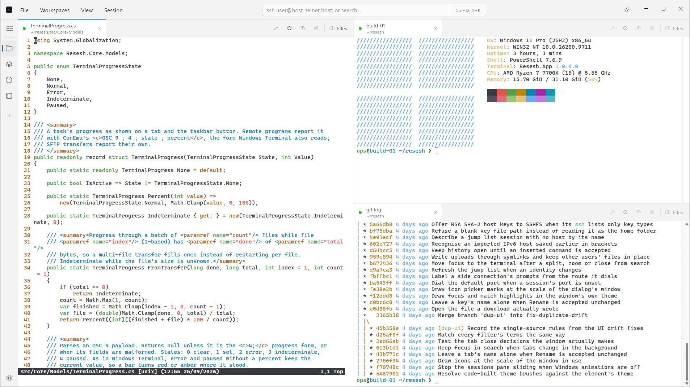
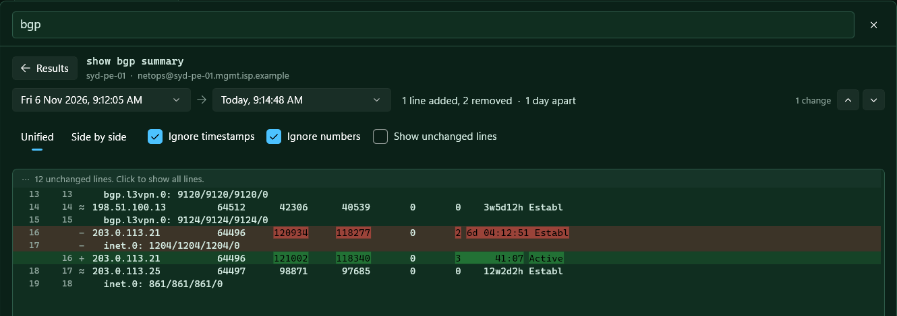
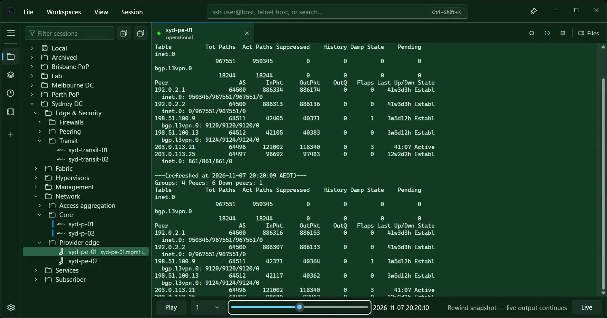
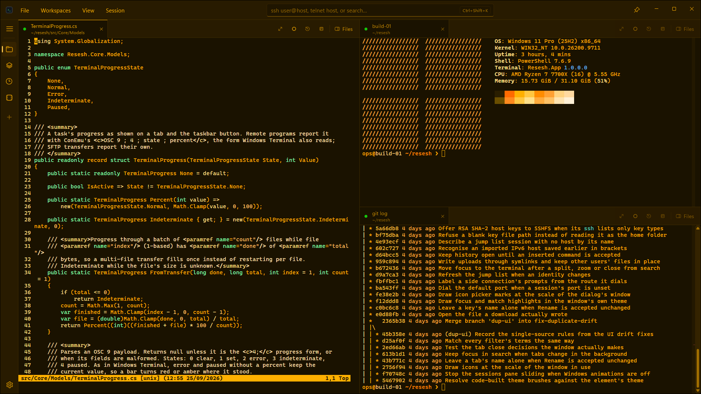

<h1 align="center">resesh</h1>

<h3 align="center">Rethinking session management.</h3>

<p align="center">
  <strong>SSH, telnet, serial and local terminals for Windows.</strong><br>
  Keep your hosts in folders, open them side by side, and find any command you ran, with its output, weeks later.
</p>

<p align="center">
  <a href="https://github.com/bpbp-boop/resesh/releases/latest"></a>
  
  <a href="LICENSE"></a>
</p>

<p align="center">
  <a href="https://github.com/bpbp-boop/resesh/releases/latest"><strong>Download</strong></a> ·
  <a href="https://resesh.net">Website</a> ·
  <a href="https://resesh.net/features.html">Every feature, with screenshots</a> ·
  <a href="https://resesh.net/shortcuts.html">Shortcuts</a>
</p>

<p align="center">
  
</p>

resesh is a tabbed terminal for people who look after hosts: routers, switches, firewalls, Linux boxes
and the occasional console cable. It was built to replace SecureCRT for daily use, and brings your
sessions over from SecureCRT, PuTTY and OpenSSH in a few clicks.

- **Free and open source.** No account, no cloud, no telemetry.
- **Native.** WinUI 3 and a GPU-drawn terminal built on Ghostty's terminal core. No browser inside.
- **Remembers for you.** Optional searchable history of every command and its output, across every host.

## Features

### Sessions, organised

- Folder tree of saved sessions with **filter-as-you-type**; press Enter to connect.
- **Quick connect** (Ctrl+Shift+K): type `ssh user@host`, `telnet host 2003` or `serial COM5 115200`.
- Icons for Linux distros, cloud providers, databases and network vendors (Cisco, Juniper, Nokia, Arista,
  VyOS, MikroTik, Fortinet, Palo Alto…). Network gear gets its icon **suggested from the login banner**.
  Drop in your own.
- **Colour tags** carried onto the tab accent.
- **Shared logins (identities):** set one username and password or key on a folder and every session
  inside uses it. Rotate a password once; a rejected one can be updated for every session that uses it.
- **Bulk edit:** one sortable table of every session. Change the login, port, colour, icon, theme,
  folder or jump host of fifty sessions at once.
- Local profiles for **PowerShell, cmd, WSL and Git Bash** in the same list.
- Pinned and recent sessions in the **taskbar jump list**.

### Every way in

- **SSH** with password, key and keyboard-interactive login.
- **Telnet** for console servers and lab gear: Send Break, window size that follows the tab, CP437 for
  ANSI art and BBSes, optional fixed 80 × 25.
- **Serial consoles:** a port picker that names the adapter (FTDI, Prolific, USB Serial Device), full line
  settings, Send Break, and a tab that **reconnects by itself** when you plug the cable back in.
- **Jump hosts** (chainable, each hop with its own login and host key check), **SOCKS5/SOCKS4/HTTP proxies**,
  and saved **local, remote and dynamic tunnels** that open with the session.
- **Persistent remote shells:** close the tab or lose Wi-Fi and the shell keeps running on the host.
  Reconnect and you're back, scrollback and all. Kept alive by a tiny resesh agent or by tmux.
- Per-session **SSH algorithm choices**, legacy ones marked, with one click to harden.

### A terminal that's actually fast

- Drawn with **Direct2D and DirectWrite** straight into the window at your display's refresh rate, using
  Windows' own text engine for **fast, sharp and accurate glyphs**.
- Every glyph advances by whole cells, so columns line up and text stays crisp at any display scaling.
- Output is parsed by **libghostty-vt** on the connection's own thread, so heavy SSH output never stalls the window.
- Box drawing, Powerline separators, braille and legacy computing glyphs drawn as shapes: **no seams at any zoom**.
- Nerd Font icons work **without a patched font**.
- **Programming ligatures** (`->`, `!=`, `===`) in fonts that have them, like Cascadia Code, Fira Code and JetBrains Mono,
  kept on the cell grid.
- Curly, dotted and dashed underlines, underline colours, true colour, OSC 8 hyperlinks.
- IME input for Japanese, Chinese and Korean, plus the emoji panel, voice typing and the touch keyboard.
- Rectangle select (Alt+drag), Shift+click to extend, per-tab zoom.
- Tabs you can't see are parsed but not drawn, so a background log flood costs no GPU time.

### Built for network engineers

- **Keyword highlighting** for interfaces, IP and MAC addresses, up/down states and routing protocols,
  or your own regular expressions, per session.
- **CLI mode on the tab:** see at a glance which tab is sitting in Junos `configure`, Cisco
  `config-if` or Nokia MD-CLI `private*` before you type into it.
- **Safe paste:** a paste that would press Enter shows you the lines and the target session first.
- **Slow paste** per line or per character for devices with tiny input buffers, with progress and Esc to stop.

### Command history and compare

<p align="center">
  
</p>

- Turn on history and resesh keeps **every finished command with its output**, host, folder, time and exit code.
- Search it all with **Ctrl+Shift+H**: `host:syd-pe in:/etc exit:fail "exact phrase"`, or pick a day on the calendar.
- Put a command back at the prompt, or reopen the session it ran in.
- **Compare runs:** diff two runs of `show bgp summary` from yesterday and today, with changed words marked.
  Timestamps and counters can be ignored so only the real change is left.
- Off by default, local only, never in backups. Deletes are overwritten on disk.

### Rewind and recording

<p align="center">
  
</p>

- **Rewind** the terminal to how it looked minutes ago while the session keeps running, then jump back to live.
- Record to **asciicast** and a **timestamped text log** at the same time.
- Built-in `.cast` player with pause, speed and seek.

### Find your way around the output

- **Annotated scrollbar** showing search matches, highlights, bookmarks and every command with its exit status.
- Hover the scrollbar to preview a line and see when it arrived.
- **Command list:** every command in the tab, in order; jump to one or copy its output.
- Jump between commands with Ctrl+Shift+↑/↓, bookmark a line with Ctrl+Shift+M, search with Ctrl+Shift+F.

### Tabs, splits and workspaces

- Split right or down, and drag tabs between panes and windows. Drop a tab outside to **tear it off**,
  connection and all.
- **Workspaces** on the left rail: save tabs, splits, sizes and pinned tabs, then switch with one click.
  The workspace you leave stays connected, with a dot when something happens there.
- Restore your last layout on startup.
- Settings and Welcome are tabs too: split them next to a terminal or move them to another window.
- On a narrow window the sessions pane floats so terminals keep their width.

### Coding agents over SSH

- Claude Code, Codex, Gemini CLI, GitHub Copilot, Cursor, OpenCode and 20+ more are recognised and
  get their own tab icon.
- Tab badges show whether an agent is **working, waiting for you, done or failed**, so you can leave it running.
- Any program can report status (OSC 7501) and progress (OSC 9;4) to the tab and taskbar. Nothing to install on the server.
- OSC 52 copy to the Windows clipboard (write-only; hosts can never read it), Shift+Enter for a new line in the prompt.
- Mouse-aware: select, copy and right-click paste still work inside agents and vim.

### Shell integration and alerts (optional)

- Exact command boundaries, exit codes and current folder for Bash, Zsh, Fish and PowerShell, locally and over SSH.
- Click the **bell** on a running command and get a Windows notification when it finishes; clicking it takes
  you to that command's output.
- **SFTP file pane** beside the terminal that follows the shell's current folder.

### Make it yours

<p align="center">
  
</p>

- Around **900 bundled themes** from iTerm2-Color-Schemes, searchable and browsable by category.
- Follow Windows light/dark mode, or keep one theme. A different theme per session.
- Colour the whole app with the theme, just the accent, or neither.
- Command palette (Ctrl+Shift+P) and a searchable shortcut list (Ctrl+Shift+/).
- Plain Ctrl+letter **always reaches the shell**, so Ctrl+R and your tmux prefix keep working.

### Safe with your data

- Passwords and passphrases live in **Windows Credential Manager**, never in resesh's files.
- Review changed host keys before accepting them; key fingerprints and named key references.
- **Backup** everything to one `.reseshbackup` file and restore on another PC. Secrets are left out unless
  you choose an encrypted backup.
- Session files are written atomically with a backup copy. A file that can't be read is set aside, never saved over.

## Bring your sessions with you

Import from **SecureCRT**, **PuTTY** (including serial and proxy settings), **OpenSSH `~/.ssh/config`**
(including `ProxyJump` and algorithm options) or a **resesh backup**. Review everything as a folder tree
before it's added; repeated logins are suggested as shared identities. Passwords are not imported.

## Install

Grab the latest build from [Releases](https://github.com/bpbp-boop/resesh/releases/latest).
Windows 10 21H2 or newer, x64 or Arm64.

| Download | Use it when |
| --- | --- |
| `-setup.exe` | **Recommended.** Self-contained, and installs the Visual C++ Runtime only if it's missing. |
| `.msi` | Scripted deployments where the Visual C++ Runtime is already present. |
| Portable `.zip` | No install; needs the Visual C++ Runtime. |

The installers install for all users, so Windows asks for administrator approval. Tagged releases are
code-signed.

resesh is in beta. Bugs and ideas go in [issues](https://github.com/bpbp-boop/resesh/issues).
See [ROADMAP.md](ROADMAP.md) for what's next: SSH agent and Pageant support, GSSAPI/Kerberos, NetBox
inventory, and more.

## Guide

<details>
<summary><strong>Persistent sessions</strong></summary>

Right-click a persistent SSH tab and choose **Manage Remote Sessions…** to list the
shells belonging to that saved connection, including when the tab is disconnected.
The same action is available from the **Session** menu and the command palette for the active tab.
The manager lists each shell by its current folder and foreground program, with its age and
whether it is detached, open in a tab, or attached somewhere else. Select a shell to **Resume**
(or double-click it), **End Session…** to terminate it after confirmation, or
**End All Detached…** to clear out every shell that no tab or other client is using.

Closing a terminal tab only detaches its persistent shell; the close dialog, including
**Close Others** and **Close All**, offers to end the sessions instead. What a new tab does
with shells that are still running is set per connection in **Session Settings › Terminal ›
When earlier shells are running**:

- **Resume it, or ask when there are several** (default) — a single detached shell resumes
  directly; otherwise a picker offers each shell, a new session, and
  an **End detached shells and start new** button.
- **Start a new shell, keep the others.**
- **End detached shells, then start a new one.**

Shells open in another tab or attached from another client are never ended automatically
and never resumed without asking.

</details>

<details>
<summary><strong>Shell integration (experimental)</strong></summary>

Shell integration adds prompt and command boundaries, exit results, and current-folder
reports to the existing command marks and file pane. It is **off by default for every
session**, including existing profiles and imported connections.

- For a local profile, turn on **Shell integration (experimental)** on its editor's Shell tab.
  Recognized Bash, Zsh, Fish, and PowerShell executables are supported. WSL, Command Prompt,
  and custom command/script launches keep their ordinary startup and show a skip notice.
- For SSH, select **Shell integration (experimental)** in the session's **Connection**
  settings: Bash, Zsh, Fish, or PowerShell (Windows). Choose the shell explicitly; keep
  **Off** for Cisco, Juniper, and other network CLIs. There is no platform discovery probe.

Changes apply to new shells. A resumed persistent shell keeps its original hooks; start a
new remote session to apply a changed preference. PowerShell integration cannot be combined
with tmux persistence. PowerShell's effective execution policy still applies and may block
the script; resesh shows a short notice and leaves the shell usable. To permit locally
created scripts for a particular local PowerShell profile, append `-ExecutionPolicy` and
`RemoteSigned` on separate lines in its Arguments box. This affects that terminal process
and its children; resesh does not change saved user or machine execution policies.

Bundled scripts load after the user's startup configuration without editing profile files.
SSH setup uses a separate, bounded exec channel and stores the scripts in the remote user's
cache. Rejected setup falls back to ordinary startup when the connection remains usable.
See [the implementation and test notes](SHELL_INTEGRATION_PLAN.md) for shell coverage and
current limitations.

</details>

<details>
<summary><strong>Notify when a command finishes</strong></summary>

While a command with shell integration is running, click the bell beside its tab subtitle
to request one completion notification. The command palette offers the same action for
the active tab. Click again to cancel. Each request applies only to that command;
notifications are not automatically armed for later commands.

If you are watching that terminal when it finishes, resesh stays quiet and keeps the
program name, elapsed time, and exit result in the subtitle tooltip. Otherwise it sends
a Windows notification; clicking it returns to the tab and the command's output when it
remains in scrollback. Command arguments are not included. An unavailable exit status is
reported as unknown, not success. Disconnecting or starting another command cancels an
outstanding request. This requires shell integration's command lifecycle reports; there
are no automatic notification rules. If Windows notifications are unavailable, resesh
shows an in-app completion notice and flashes the taskbar instead.

Notification clicks target the live originating app; they never reopen a closed session.
Clicks may not route when separate app processes with different `--data-dir` values run
concurrently. Multiple windows within one app process are supported.

</details>

<details>
<summary><strong>Command history</strong></summary>

Turn on **Settings → Recording → Command history** (or the button in the history view) to
keep every finished command with its output, folder, session, time, and exit result.
Press Ctrl+Shift+H, or use View → Command History, to search it across all sessions.

- Words must all match the command, session, folder, or output. Quote a phrase with
  `"…"`. Narrow with `host:web01`, `in:/etc`, `exit:fail`, `exit:ok`, or `exit:127`, or
  use the session, result, and time filters.
- Enter types the selected command at the active tab's prompt without running it.
  Ctrl+Enter opens its session in a new tab. F3 and Shift+F3 step through matches in the
  output.
- **Compare runs:** when a command has run more than once on the same host, the detail
  pane offers "Compare with Previous" and a list of every run with how it differs. The
  comparison shows added and removed lines with changed words marked, unified or side by
  side. Timestamps are ignored by default; numbers can be ignored too. F7 and Shift+F7 step
  between changes. Runs that went through a pager (`--More--`) or were cut at 64 KB are
  flagged, because their output is incomplete.
- Commands are found from shell integration (with exit codes) or from shell prompts
  (without). Output keeps its first 64 KB; output that leaves the scrollback before the
  command ends is not kept.
- History is off by default because output can contain secrets. A saved session can turn
  it off in its options. Entries older than the retention period (90 days by default)
  are deleted at startup; Settings can clear all history, and the view deletes single
  entries. Deleted history is overwritten on disk, not just unlinked. History is local
  only and is not included in backups.
- Search uses a SQLite full-text index, so history does not have to fit in memory. Words
  of three or more characters use the index; shorter words are matched by a scan.

</details>

<details>
<summary><strong>Serial consoles</strong></summary>

Choose **File › New Serial Session…**, or type `serial COM5`, `serial COM5 115200` or
`serial COM5 115200 7E1` in quick connect. The port picker lists the ports present now
with their device names ("COM5 — USB Serial Device"); **Refresh** picks up a cable plugged
in after the editor opened. Speed, data bits, parity, stop bits and flow control (none,
XON/XOFF, RTS/CTS) are set per session; the default is 9600 8N1 with no flow control.

- **Send Break** (Session menu, tab menu, command palette, Ctrl+Break) holds the line in
  the break state for 300 ms, after whatever was typed before it has gone out.
- Unplugging the adapter disconnects the tab and says so. The tab watches for the port and
  reconnects when it returns. A session whose port is missing when it opens waits the same way.
- DTR and RTS are raised on open (RTS is left to the driver with RTS/CTS), as PuTTY and
  SecureCRT do; some adapters send nothing until they see them.
- PuTTY serial sessions import with their line settings. DSR/DTR flow control has no
  equivalent here and imports as none.

</details>

<details>
<summary><strong>Safe paste</strong></summary>

A paste that would press Enter asks first: the confirmation names the session, shows the
first lines, and defaults to Cancel. There is no question when the program has turned on
bracketed paste (shells usually do), because pasted line breaks then reach it as text.
Turn the question off in **Settings › Terminal › Confirm multi-line pastes**, or with
**Don't ask again** in the question itself.

For devices that drop characters from a fast paste, set **Paste: wait after each line**
or **wait after each character** in the session's Terminal settings (50–200 ms per line
suits most console lines). A slow paste shows its progress in the status bar; typing any
key stops it, and Esc stops it without sending anything. Pastes into a program with
bracketed paste on are never slowed.

</details>

<details>
<summary><strong>Mouse in programs</strong></summary>

Programs that use the mouse, such as Claude Code, Codex and vim, get only the scroll wheel
by default. Dragging still selects, selections still copy, and right-click still pastes,
as at a shell prompt. Hold Shift to send a click to the program instead. To give programs
clicks too (Shift then selects), or nothing at all, change **Settings › Terminal › Mouse in
programs**, or override it for one session in its Appearance settings.

</details>

<details>
<summary><strong>Themes</strong></summary>

In **Settings › Theme**, set **Appearance** to **System** to switch between a light and a
dark theme when Windows does (pick one of each), or to **Theme** to always use one theme.
Built-in themes sit alongside around 900 bundled themes from
[iTerm2-Color-Schemes](https://github.com/mbadolato/iTerm2-Color-Schemes); search them by
name or browse by category: Traditional, Cool, Warm, Pastel, Vivid, Retro and High contrast.
Each preview shows a prompt and some log output with your highlighting rules applied, as a
terminal would show it. **Color the app with the theme** picks how far the theme reaches
beyond the terminal and chrome: **Accent** (the default) takes resesh's highlight color from
the theme, **Everything** also colors every standard control (text, buttons, inputs,
switches, lists, menus, dialogs and tooltips), tab titles and the window buttons,
and **Off** keeps the standard blue and Windows colors. Theme changes apply and save
immediately. A session can still override its terminal theme in its Appearance settings.

</details>

<details>
<summary><strong>Tabs and windows</strong></summary>

Drag a tab onto another pane's tab strip to move it there, or onto a pane's terminal to
split it toward the side you drop on; both work across windows. Drop a tab outside every
resesh window to tear it off into a new window under the pointer, connection and all.
Dragging a window's only tab out moves that window instead. Press Escape during the drag,
or drop on a part of a window that isn't a tab strip or pane, to leave the tab where it
was. Pinned tabs stay put.

</details>

<details>
<summary><strong>SSH algorithms</strong></summary>

**Settings › Identities & Keys › SSH algorithms** chooses which key exchange, cipher, MAC
and host key algorithms SSH sessions offer, with a check box for each. Everything is on by
default, including the older algorithms legacy devices need (`diffie-hellman-group1-sha1`,
`diffie-hellman-group14-sha1`, `aes128-cbc`, `3des-cbc`, `ssh-rsa`); they are marked
*legacy*, and **Turn legacy off** clears them in one step to harden connections.

A session's **Advanced** tab (which also holds shell integration) can choose differently.
Each kind follows the app setting until **Use the app setting** is cleared for it; the
session then keeps its own choices for that kind only. Algorithms are always offered in
SSH.NET's order of preference. Settings store what is turned off, so an algorithm a later
SSH.NET adds is offered without an edit.

`KexAlgorithms`, `Ciphers`, `MACs` and `HostKeyAlgorithms` in `~/.ssh/config` import as
the same on/off choices (their order is not kept; names SSH.NET does not implement, such as
`ssh-dss` or `hmac-md5`, are ignored). When a host and resesh have nothing in common, the
error names what the host offers and where to turn it on.

Hover the status bar on a connected SSH tab to see what the connection negotiated (key
exchange, cipher, MAC and host key, legacy ones marked); the status line itself says
"legacy algorithms" when any is in use. A connection offers the host key type already
trusted for that host first, as OpenSSH does, so the host keeps showing that key. If that
type is turned off, the connection says so instead of reporting a changed host key.

</details>

<details>
<summary><strong>Where your data lives</strong></summary>

| What | Where |
| --- | --- |
| Sessions + folders | `%APPDATA%\Resesh\sessions.json` (atomic writes, one `.bak` rotation) |
| Shared logins (identities) | `%APPDATA%\Resesh\identities.json` |
| Workspaces + clean-exit layout | `%APPDATA%\Resesh\workspaces.json` (atomic writes, one `.bak` rotation) |
| Settings, highlight rules, key references | `%APPDATA%\Resesh\settings.json`, `highlights.json`, `ssh-keys.json` |
| Secrets (passwords, key passphrases) | Windows Credential Manager, `Resesh:{session-guid}` |
| Accepted host keys | `%APPDATA%\Resesh\known_hosts.json` |
| Exported backups | User-selected `*.reseshbackup` file |
| Command history (when on) | `%LOCALAPPDATA%\Resesh\history\history.db` (SQLite with a full-text index; deletes overwrite the removed data) |
| Crash log | `%LOCALAPPDATA%\Resesh\crash.log` |

Secrets are **never** written to the normal JSON store. They are excluded from backups by
default. When included, the complete backup is encrypted with its passphrase.

Session files with invalid local directory or argument values use the same backup recovery
as other unreadable session files. The invalid file is kept aside, and the app shows a
recovery warning. A file with two sessions sharing one ID still loads; the first is kept.

Pass `--data-dir <folder>` to keep everything in a folder of your choice instead; passwords
are then stored DPAPI-encrypted in that folder rather than in Credential Manager.

</details>

## Building from source

Requires the .NET 10 SDK on Windows 10 21H2 or later, and Git. The build also builds the terminal's
native libraries with `eng/build-ghostty-vt.ps1` whenever they are missing or out of date (it downloads
the pinned Zig and Ghostty commit; `-BuildRoot` holds about 2 GB of toolchain and caches), so the
first build takes several minutes:

```
dotnet build src/App/Resesh.App.csproj -p:Platform=x64
src/App/bin/x64/Debug/net10.0-windows10.0.19041.0/Resesh.App.exe
```

On ARM64, use `-p:Platform=ARM64`. The native step reruns when `eng/ghostty-vt.json`, the script or
`src/Terminal/Native/Shim/` changes; pass `-p:SkipGhosttyVtBuild=true` to skip it.

Built on WinUI 3 (Windows App SDK 2.4), C# and .NET 10, [SSH.NET](https://github.com/sshnet/SSH.NET)
for transport, and [libghostty-vt](https://github.com/ghostty-org/ghostty) drawn with Direct2D/DirectWrite
into a XAML `SwapChainPanel`. Release builds are unpackaged, self-contained and Native AOT.
Contributor conventions are in [AGENTS.md](AGENTS.md); version-specific findings and design decisions
are in [DECISIONS.md](DECISIONS.md).

### Demo mode

Launch an isolated demo with a populated session tree (this is how the screenshots are taken):

```powershell
.\demo.ps1
```

The script builds the app for the current processor architecture and starts it with
disposable demo data. It does not read or change the normal resesh sessions, settings, or
credentials. Use `.\demo.ps1 -Platform ARM64` to override the detected architecture.

### Tests

```
dotnet test tests/Core.Tests
dotnet test tests/AppLogic.Tests
dotnet test tests/Terminal.Tests -p:Platform=x64
node --test tests/*.js
```

The app-logic tests execute the production view models without a WinUI window. They cover
live tab ownership and cleanup. Core tests cover connection cancellation, failed writes,
host-key recovery, and exact workspace pane measurements. JavaScript source checks remain
useful for UI wiring; they do not replace interactive UI tests.

Open `tests/Fixtures/Terminal/webgl-resize.html` in a WebGL2-capable browser for the
GPU canvas-resize regression. It checks rendered pixels and reports PASS/FAIL.

### Local test SSH server

A throwaway echo server for exercising the terminal end to end (password auth, host keys,
10 MB dumps, window-change, server-side close):

```
dotnet run --project tools/TestSshServer
```

Listens on `127.0.0.1:2200`, accepts `test` / `test123`. The seeded session **Lab/local-test**
connects to it. Commands: `big` (10 MB dump), `bye` (server-side close); anything else echoes.

### Release builds

GitHub Actions builds and tests each push to `master` and each pull request, producing the setup
bundle, MSI and portable ZIP for x64 and Arm64. To create a GitHub release, push a numeric
semantic-version tag such as `v1.2.3`. Tagged builds sign the app binaries, the MSI, and the setup
bundle with the Certum code-signing certificate (the `code-signing` environment), then publish all
six files with SHA-256 checksums. Branch and pull-request builds are unsigned, so Windows shows an
unknown-publisher warning for them.

### Project layout

```
src/App               WinUI 3 app (views, viewmodels, dialogs)
src/Core              models, session store, importers, SSH/SFTP, shell integration,
                      credential service — no UI dependencies
src/Terminal          the terminal surface (libghostty-vt shim, renderer, ruler, find)
tests/Core.Tests      core unit tests
tests/AppLogic.Tests  view-model tests without a WinUI window
tests/Terminal.Tests  terminal surface tests
tests/*.js            JavaScript source checks (run with `node --test`)
installer/            WiX MSI and setup bundle
eng/                  MSBuild targets, patches and the libghostty-vt build
tools/                TestSshServer, KeepaliveProbe, terminal benchmarks and the screenshot rig
website/              project website
```

## License

[GPL-2.0](LICENSE)
